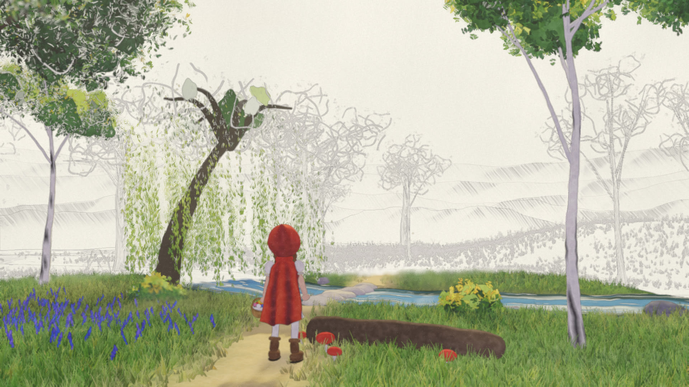
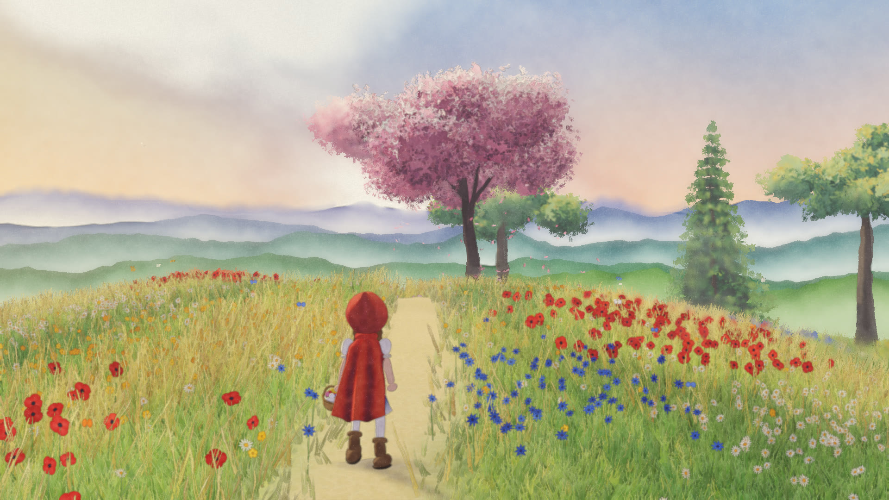
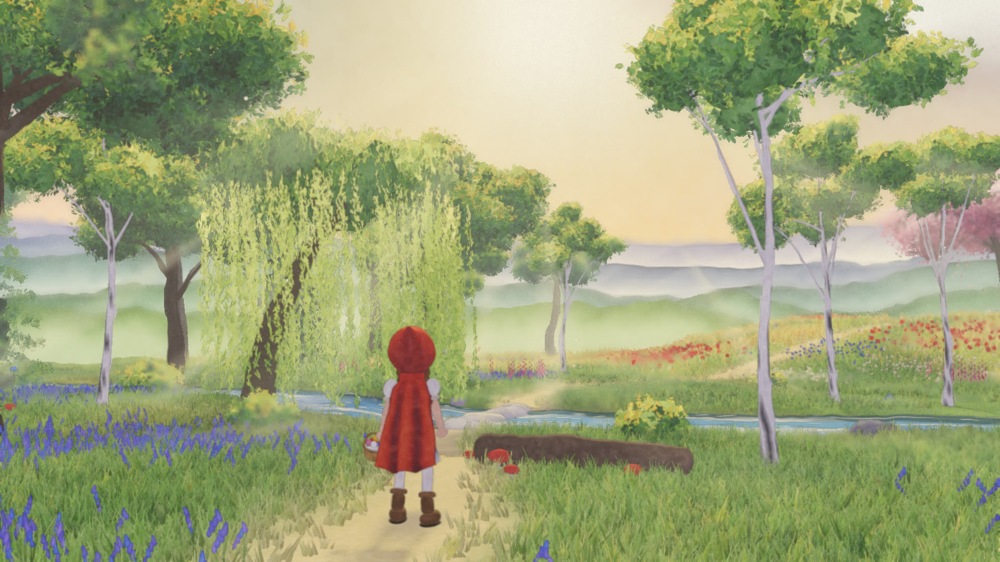
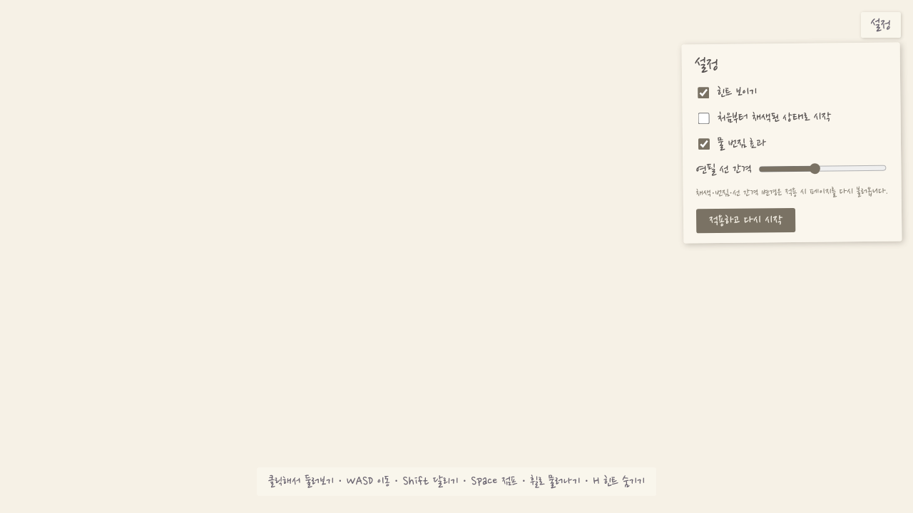

# 수채화 (Watercolour 한국어판)

연필로 그린 풍경 속을 걸으면, 걸음마다 수채 물감이 번져 나가며 세상이 채색되는 산책 데모입니다. [patch.gg의 Watercolour](https://patch.gg/blendi/watercolour)(작가: blendi)를 한국어로 옮긴 버전입니다.



*장면 스크린샷은 원작 데모의 캡처입니다. 한국어판도 같은 장면을 렌더링하며, 달라진 점은 한국어 UI뿐입니다.*

## 소개

발밑에서 물감의 번짐이 고르지 않은 젖은 가장자리로 퍼져 나가고, 나무는 뿌리에서 잎까지 물들고, 시냇물을 따라 흘러내리고, 지나간 자리에는 그대로 남습니다. 데모는 늦은 오후의 숲 가장자리, 디딤돌이 놓인 시내, 그리고 꽃이 핀 나무 하나가 있는 목초지입니다. 빨간 망토를 두른 작은 아이가 물감을 가져옵니다.

숲길을 따라 걷고, 디딤돌로 시내를 건너고, 목초지를 지나 꽃이 핀 나무에 닿으면 마지막 물감이 모든 것 위로 번집니다.





## 조작법

- **클릭**: 마우스로 둘러보기
- **WASD / 방향키**: 이동
- **Shift**: 달리기
- **Space**: 점프
- **마우스 휠**: 시점을 뒤로/앞으로
- **H**: 힌트 숨기기/보이기
- 게임패드도 사용할 수 있습니다. 소리는 없습니다.

## 설정

오른쪽 위 **설정** 버튼(한국어판에서 추가)에서 바꿀 수 있습니다.

- **처음부터 채색된 상태로 시작**: 완성된 그림부터 봅니다(URL의 `?painted`와 같습니다).
- **물 번짐 효과**: 종이가 젖은 곳에서 물감이 번지는 효과를 켜고 끕니다(`?wet=0`으로 끄는 것과 같습니다).
- **연필 선 간격**: 연필 밑그림 선의 간격을 조절합니다(`?px`와 같습니다).
- **힌트 보이기**: 화면 아래 조작 힌트를 켜고 끕니다.



## 설치 및 실행

```bash
npm install
npm run build        # dist/ 에 배포용 파일이 만들어집니다
npm run serve        # http://127.0.0.1:5405/
```

정적 파일만으로 동작하므로 `dist/`를 그대로 아무 정적 호스팅에나 올리면 됩니다. 이 저장소는 GitHub Pages로 배포되어 있습니다: https://sigco3111.github.io/watercolour-ko/

## 기술 노트

- 사진에 필터를 씌운 것이 아니라, 종이에 먼저 연필로 그리고 나중에 물감을 칠하는 방식으로 그립니다.
- `src/wash.js`의 `createWash()`가 땅의 모든 지점에 물감이 도착한 시각을 기록합니다. `paint.touch(x, z, now)`가 물감을 놓고, `paint.flood()`가 전체에 한 번의 물결을 보냅니다.
- 모든 것에는 물감을 받아들이는 뿌리가 있습니다. 나무는 뿌리에서부터 위로 채색되고, 꽃밭은 한꺼번에 피어납니다. 데모에는 약 65만 번의 붓 터치가 들어 있습니다.
- 색이 입혀진 다음에야 풀이 흔들리고, 시내가 흐르고, 꽃잎이 지고, 나비가 납니다.
- 빠른 데스크톱 GPU에서 프레임당 약 4~6ms, 세계를 만드는 데 약 4.5초가 걸립니다. 다운로드 크기는 약 9MB입니다.

원본의 자세한 설명은 [README.original.md](README.original.md)(영문)에 있습니다.

## 라이선스 및 크레딧

- 원작: [Watercolour](https://patch.gg/blendi/watercolour) by **blendi** (Patch)
- 코드: MIT, 아트: CC0 1.0 — 모든 그림 요소는 코드로 만들어집니다.
- 아이의 움직임은 Patch의 스타터 스켈레톤과 Quaternius의 Universal Animation Library 클립(CC0)을 사용합니다. 물리 엔진은 Rapier(Apache-2.0)입니다.
- 자세한 출처는 [LICENCE-NOTES.md](LICENCE-NOTES.md)와 [LICENSE](LICENSE)를 참고하세요.
- 한국어 번역 및 독립 실행용 설정 패널은 이 저장소에서 추가되었습니다.
